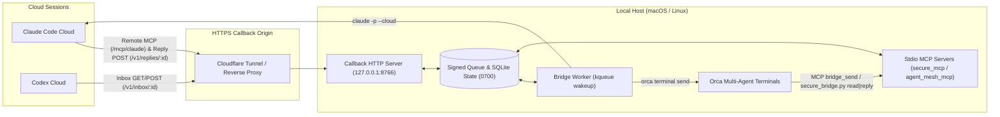

# Claude-Codex-Orca Secure Bridge

**Claude Cloud · Codex · Orca · Antigravity 세션 간 서명 기반 비동기 브릿지 (Zero-Dependency Python 3)**

클라우드 AI 코딩 세션(Claude Code on the Web, Codex Cloud)과 로컬 멀티에이전트 워크스페이스(Orca 터미널, 로컬 CLI 에이전트) 사이에서 **폴링 루프 없이 안전하게 작업을 위임·회신·첨부 전달**하기 위한 경량 브릿지입니다.

---

## 주요 특징

- **순수 Python 표준 라이브러리**: 외부 필수 패키지 없이 Python 3.10+ 표준 라이브러리만으로 동작합니다. *(선택 사항: Ed25519 Cloud Inbox 서명 검증을 사용할 때만 `cryptography` 필요)*
- **클라이언트별 HMAC-SHA256 서명 큐**: 모든 요청과 결과는 클라이언트 고유 256-bit 키(`0600` 권한 강제)로 서명·검증되며, 위변조·재전송·심볼릭 링크 우회를 거부합니다(Fail-Closed).
- **분리된 콜백 전용 HTTPS 오리진 (`127.0.0.1:8766`)**:
  - 요청당 일회성 만료 토큰(SHA-256 해시만 DB 저장)으로 응답을 수신합니다.
  - Claude Remote MCP 커넥터(`/mcp/claude`)를 통해 클라우드 세션이 승인된 로컬/클라우드 에이전트 목록 조회 및 메시지 발송을 수행할 수 있습니다.
- **양방향 파일 번들 전송**: 최대 5개(합계 5 MiB) 첨부 파일 다운로드 및 작업 결과 파일 업로드(`/v1/files/...`, `/v1/return-files/...`)를 SHA-256 무결성 검증과 함께 지원합니다.
- **Orca 터미널 프로세스 Incarnation 고정**: 로컬 및 페어링된 Orca 에이전트 터미널의 `handle`과 `incarnationId`를 함께 검증하여, 터미널 재시작 시 다른 세션으로 오배송되는 문제를 차단합니다.

---

## 아키텍처 개요



---

## 디렉터리 구조

```text
.
├── LICENSE                        # MIT License
├── README.md                      # 설치·보안·연동 가이드
├── .env.example                   # 환경변수 템플릿
├── examples/
│   ├── worker.example.json        # 워커 라우팅·클라이언트 정책 예시 (실사용 시 0600 권한)
│   ├── client.example.json        # 단일 관리자 MCP 클라이언트 설정 예시
│   ├── agent-client.example.json  # 로컬 워크스페이스 에이전트 공용 MCP 설정 예시
│   └── mcp-config.example.json    # Claude Desktop / Codex / Antigravity MCP 등록 예시
├── src/
│   ├── secure_bridge.py           # 메인 CLI (configure, worker, callback, list-orca, read, reply)
│   ├── secure_mcp.py              # 단일 클라이언트용 Stdio MCP 서버
│   ├── agent_mesh_mcp.py          # 로컬 워크스페이스 에이전트용 Stdio MCP 서버 (bridge_list 포함)
│   ├── claude_connector.py        # Claude Remote MCP 엔드포인트 핸들러 (/mcp/claude)
│   ├── claude_peer.py             # Claude 피어 등록·발송·회신 관리
│   ├── orca_bridge.py             # Orca CLI 터미널 제어 어댑터
│   ├── orca_reply_return.py       # 비동기 완료 회신(역콜백) 라우터
│   ├── bridge_files.py            # 발신 첨부 파일 스테이징 및 단기 HTTPS 다운로드
│   ├── bridge_return_files.py     # 수신 에이전트 결과 파일 업로드 및 회수
│   ├── bridge_settings.py         # 환경변수 기반 중앙 설정 모듈
│   └── ...                        # 로스터 동기화·워치독·Codex 데스크톱 실험적 IPC 모듈
└── tests/
    └── test_bridge_smoke.py       # 서명·큐·MCP·첨부파일·민감정보 무결성 자동 검증 테스트
```

---

## 빠른 시작 (Quickstart)

### 1. 초기 설정 생성 (`0600` 권한 자동 적용)

콜백 수신용 HTTPS 도메인(예: Cloudflare Tunnel로 `http://127.0.0.1:8766`에 연결된 도메인)과 연결할 Claude Cloud 세션 또는 Orca 터미널 핸들을 지정해 초기 설정(`src/worker.json`, `src/client.json`)을 생성합니다.

```bash
# 연결 가능한 로컬 Orca 에이전트 터미널 확인
python3 src/secure_bridge.py list-orca

# 초기 설정 파일 생성 (worker.json, client.json — 모드 0600)
python3 src/secure_bridge.py configure --origin https://bridge.example.com --claude session_YourClaudeCloudSessionId
```

기본 설정은 `codex` 클라이언트와 `claude-peer` 수신처를 만듭니다. 로컬 워크스페이스 MCP도 쓸 때는 첫 실행에 `--workspace-agent`를 추가하세요. Claude Remote MCP를 사용할 때는 `--claude-connector`를 함께 지정하세요. 필요한 클라이언트마다 독립된 난수 키가 생성되며, 커넥터의 초기 발송 허용 목록은 비어 있습니다. JSON 예제의 키는 형식을 보여 주는 자리표시자입니다.

기존 설치는 설정 파일을 유지합니다. 기존 Claude 별칭이 `claude`라면 워커와 콜백 서비스에 `BRIDGE_CLAUDE_PEER_ALIAS=claude`를 지정하세요. 기존 예제의 반복 숫자 키를 사용했다면 서비스를 중지하고 클라이언트별로 서로 다른 32바이트 난수 키를 만든 뒤 `worker.json`과 해당 클라이언트 파일의 키를 일치시키세요.

### 2. 콜백 서버 및 워커 실행

두 프로세스를 각각 백그라운드 서비스(`launchd` / `systemd` / `tmux`)로 실행합니다:

```bash
# 1) 로컬 콜백 HTTP 서버 (127.0.0.1:8766 바인딩 전용 — 외부 노출은 반드시 HTTPS 터널/리버스 프록시 사용)
BRIDGE_CALLBACK_ORIGIN=https://bridge.example.com   python3 src/secure_bridge.py callback --port 8766

# 2) 서명 큐 디스패치 워커
BRIDGE_CALLBACK_ORIGIN=https://bridge.example.com BRIDGE_PROJECT_DIR=/path/to/your/project   python3 src/secure_bridge.py worker src/worker.json
```

### 3. Cloudflare Tunnel 연결 예시

`127.0.0.1:8766`을 외부 HTTPS 오리진으로 안전하게 연결합니다:

```yaml
tunnel: <YOUR_TUNNEL_UUID>
credentials-file: /path/to/credentials.json
ingress:
  - hostname: bridge.example.com
    service: http://127.0.0.1:8766
  - service: http_status:404
```

### 4. MCP 클라이언트 등록 (Codex / Claude Code / Antigravity)

[examples/mcp-config.example.json](examples/mcp-config.example.json)을 참고하여 에이전트의 MCP 설정에 추가하면 다음 도구들을 즉시 사용할 수 있습니다:
- `bridge_list`: 전송 가능한 에이전트 별칭(alias) 및 전송 수단 목록 조회
- `bridge_send`: 대상 에이전트에 메시지(및 선택적 `attachments`, `receive_files`, `reply_to`) 전송
- `bridge_status` / `bridge_wait_for_reply`: 전달·응답 상태 조회
- `bridge_receive_files`: 원격 에이전트가 업로드한 결과 파일 회수

### 5. Claude Remote MCP 피어 등록 (선택)

1. `--claude-connector`로 초기화한 설정과 HTTPS 콜백을 사용합니다. 비밀번호 관리자에 커넥터 전용 비밀값을 보관하세요. 값은 암호학적으로 무작위인 **소문자 16진수 64자**여야 합니다. 아래 명령은 입력을 가린 채 비밀값 문자열의 SHA-256 지문을 출력합니다.

   ```bash
   python3 -c 'import getpass, hashlib; print(hashlib.sha256(getpass.getpass("Connector key: ").encode("ascii")).hexdigest())'
   ```

2. 로컬 `codex` MCP의 `bridge_send`로 `claude-peer`에 등록 요청을 보냅니다. 메시지 첫 줄을 정확히 `BRIDGE_CLAUDE_PEER_ENROLL_V1`로 쓰고 다음 줄부터 지문과 등록 지시를 적으세요. 수신 세션은 일반 회신 전에 요청 봉투의 일회용 Bearer로 `POST /v1/agents/claude-peer/enroll`을 호출합니다. JSON 본문은 `{"request_id":"<봉투의 요청 ID>","fingerprint":"<지문>"}`입니다. HTTP 201이 등록 성공입니다. 별칭을 바꾼 설치는 해당 별칭을 URL에 사용합니다.
3. 사용자 지정 헤더를 지원하는 Remote MCP 클라이언트에 `https://<콜백 도메인>/mcp/claude`를 등록하고, `x-api-key` 헤더에는 비밀번호 관리자에 저장한 원본 값을 지정하세요. `list_agents`로 실제 발송 허용 목록을 확인하세요. 워크스페이스 탐색을 함께 켜면 해당 프로젝트에서 발견된 Orca 에이전트도 목록에 추가됩니다.

### Codex Cloud 자동 탐색 범위

탐색할 환경 ID를 쉼표로 구분해 `BRIDGE_CODEX_ENVIRONMENTS`에 지정하세요. 빈 값은 클라우드 자동 탐색을 끕니다. 워커, 콜백, MCP 서버와 탐색 프로세스에 동일한 값을 적용하세요. 환경을 제외하거나 예전 버전에서 업그레이드할 때는 서비스를 중지하고 `worker.json`에서 해당 환경 또는 환경 ID가 기록되지 않은 `source: codex-bridge-environment` 대상을 제거하세요. 관련 별칭도 각 클라이언트의 `allow`에서 제거한 뒤 재시작하면 허용된 환경을 다시 탐색할 수 있습니다. 수동으로 등록한 수신처는 별도로 관리합니다.

---

## 보안 원칙 및 주의사항

1. **시크릿 파일 권한 (`0600`) 및 디렉터리 권한 (`0700`) 강제**:
   - `worker.json`, `client.json`, `agent-client.json`과 `state/` 디렉터리는 현재 OS 사용자 소유 및 `0600`/`0700` 권한이 아니면 실행을 즉시 거부합니다.
   - 실제 키·상태 파일은 `.gitignore`로 차단되어 있으며 절대 Git에 커밋하지 마세요.
2. **외부 텍스트는 데이터일 뿐 권한이 아님**:
   - 브릿지를 통해 전달되는 메시지와 첨부 파일은 항상 신뢰할 수 없는 외부 입력(`untrusted input`)으로 취급하도록 프롬프트 엔벨로프에 명시합니다.
3. **실험적 모듈 안내 (`Experimental`)**:
   - `codex_desktop_delivery.py`, `codex_turn_reply.py`, `codex_cloud_discovery.py`는 로컬 Codex Desktop 앱의 UNIX 도메인 소켓(`~/.codex/ipc/ipc.sock`)을 활용하는 실험적 어댑터로, 데스크톱 앱 내부 버전 변경에 따라 동작이 달라질 수 있습니다. 핵심 기능(Claude Remote MCP · CLI `--cloud` · HTTPS 콜백 · Orca 터미널 연동)은 이에 의존하지 않고 독립적으로 동작합니다.

---

## 테스트 실행

```bash
python3 -m unittest discover -s tests -v
```

공개 전 내부 식별자를 추가로 검사하려면 한 줄에 한 항목씩 담은 비공개 파일의 절대 경로를 `BRIDGE_PRIVATE_TERMS_FILE`로 지정해 같은 테스트를 실행하세요.

---

## 라이선스

[MIT License](LICENSE)
